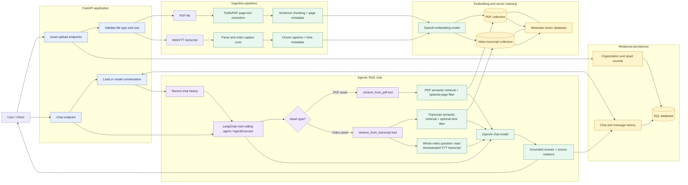

# System architecture

## End-to-end architecture

This is the single system view for the standalone PDF and video RAG
assistant. It shows both indexing paths and the shared conversational
RAG path. The agent is created for the selected asset type, so a PDF
chat receives the PDF retrieval tool and a video chat receives the
transcript retrieval tool.

## Architecture walkthrough

### 1. Upload and indexing

The client uploads either a PDF or a WebVTT transcript. FastAPI validates
the upload, creates an asset record, and calls the matching ingestion
pipeline.

- **PDF RAG:** PyMuPDF extracts text page by page. Text is chunked and
  each chunk retains its original page number.
- **Video RAG:** WebVTT cues are parsed in chronological order. Chunks
  retain the cue start and end times, so retrieval can refer back to a
  point or interval in the video.
- Both pipelines create embeddings and store vectors with
  `asset_id`, `organization_id`, and source metadata in Weaviate.

### 2. Chat and agent execution

The chat endpoint checks that the asset is ready and belongs to the
requested organization. It loads the latest 12 messages from SQL and
passes them to the LangChain agent.

The agent is configured according to the asset type:

- For a PDF, it registers `retrieve_from_pdf`.
- For a video, it registers `retrieve_from_transcript`.

The model can call the registered tool to retrieve supporting context.
The transcript tool supports semantic search, timestamp/range filters,
and a whole-video mode that reads the stored VTT transcript. The model
then produces an answer grounded in the retrieved content.

### 3. Persistence and isolation

SQLAlchemy stores organizations, assets, chats, and messages.
Weaviate stores the embedded chunks. Retrieval filters by both
`asset_id` and `organization_id`; chat history is scoped to the
conversation, user, and organization.

The current API accepts user and organization identifiers in request
data. They are used for scoping, not authentication. A public deployment
must authenticate callers and derive these identifiers from verified
identity.

## Code map — open these files during the explanation

| Component in the diagram | Implementation | What to explain |
|---|---|---|
| FastAPI application, upload and chat endpoints | [app/main.py](https://github.com/kaaviya98/video-pdf-rag-assistant/blob/main/app/main.py) | Request lifecycle, validation, orchestration, history and citations |
| Configuration | [app/config.py](https://github.com/kaaviya98/video-pdf-rag-assistant/blob/main/app/config.py) | Environment-backed model, database and vector settings |
| SQLAlchemy engine and sessions | [app/database.py](https://github.com/kaaviya98/video-pdf-rag-assistant/blob/main/app/database.py) | Database connection and request-scoped session |
| Organization, asset, chat and message records | [app/models.py](https://github.com/kaaviya98/video-pdf-rag-assistant/blob/main/app/models.py) | Relational data model |
| API request and response schemas | [app/schemas.py](https://github.com/kaaviya98/video-pdf-rag-assistant/blob/main/app/schemas.py) | Input validation and response contracts |
| PDF and video transcript ingestion | [app/ingestion.py](https://github.com/kaaviya98/video-pdf-rag-assistant/blob/main/app/ingestion.py) | Extraction, chunking and source metadata |
| Agent, tool registration and retrieval | [app/agent.py](https://github.com/kaaviya98/video-pdf-rag-assistant/blob/main/app/agent.py) | Tool definitions, filters, prompt and AgentExecutor |
| Embeddings and Weaviate | [app/vector_store.py](https://github.com/kaaviya98/video-pdf-rag-assistant/blob/main/app/vector_store.py) | Embedding model, collections and vector-store adapter |

## Important scope notes

- Video RAG in this project is **transcript-based**. The input is a
  WebVTT captions file; this service does not extract audio from raw
  video or perform speech-to-text transcription.
- Whole-video questions use the complete stored VTT transcript as
  context. This implementation does not generate or persist video notes.
- Ingestion currently runs synchronously in the upload request.
- The project is a proof of concept: authentication, background workers,
  durable object storage, database migrations and production monitoring
  are not yet implemented.
