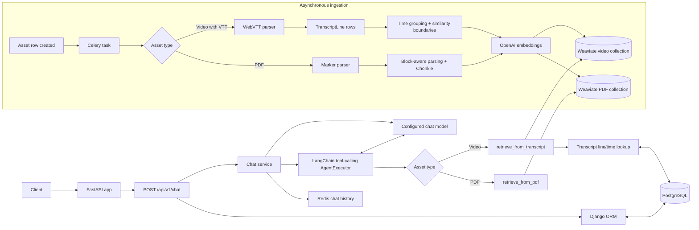
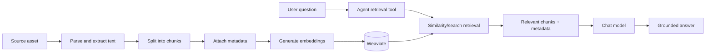
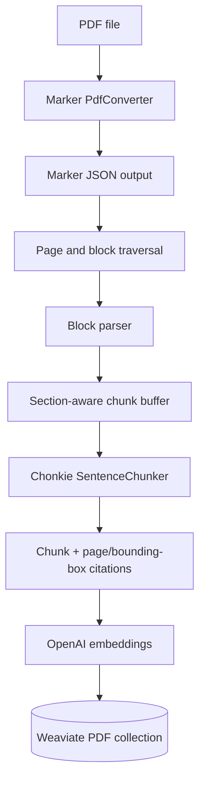
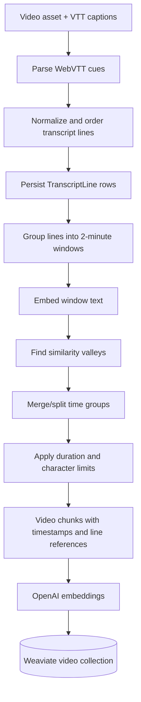
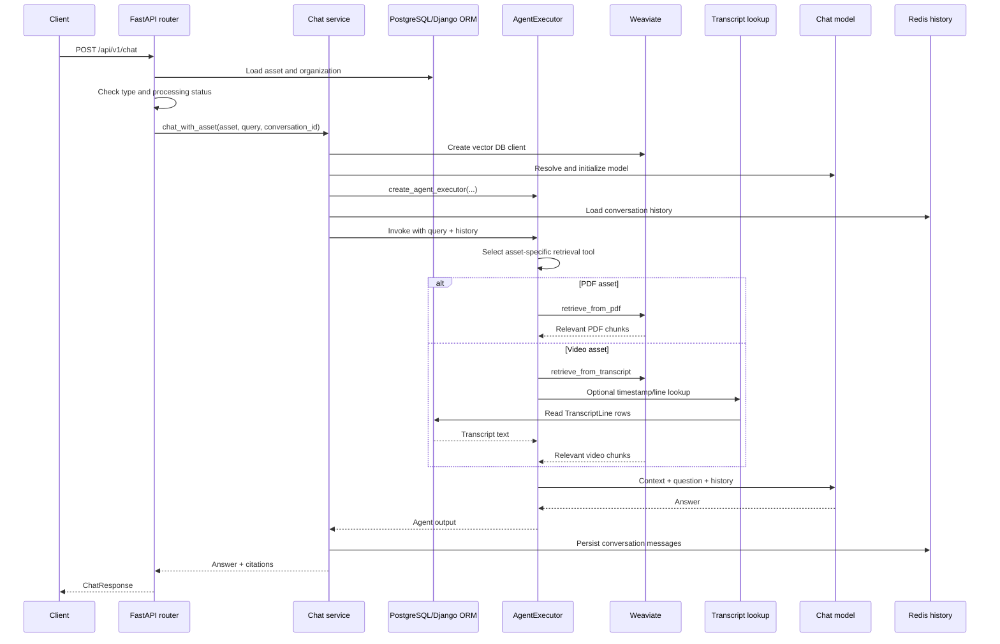
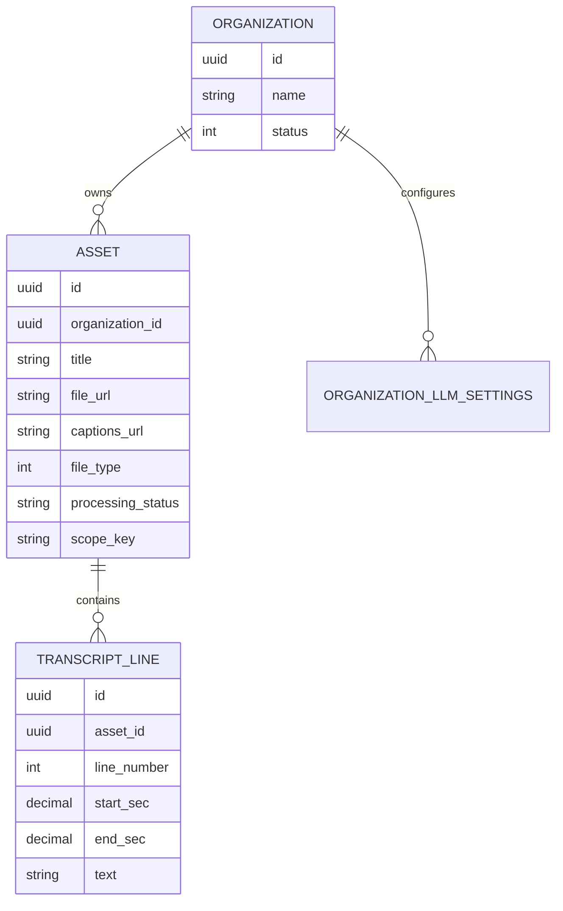

# LearnLens System Architecture

This document describes the running application, the PDF/video ingestion
pipelines, the retrieval-augmented generation (RAG) flow, and the source files
that implement each part.

## 1. RAG pipeline overview

The original LearnLens RAG pipeline is shown first to explain the core
retrieval-augmented generation process before looking at the application
architecture below.

The high-level flow is: extract content from a PDF or video transcript,
split it into meaningful chunks, generate embeddings, store those vectors,
retrieve the most relevant chunks for a question, and use the language model
to generate a grounded answer.

## 2. Complete system architecture

The application exposes one FastAPI chat endpoint. Django ORM owns relational
data in PostgreSQL. Celery handles ingestion asynchronously. Weaviate stores
vectors, Redis stores chat history, and LangChain's tool-calling
`AgentExecutor` coordinates retrieval for each question.

### Runtime components and source files

| Component | Responsibility | Source |
|---|---|---|
| FastAPI application | Initializes Django and exposes the app | [app/main.py](../app/main.py) |
| Chat route | Validates asset type/readiness and accepts chat requests | [app/api/router.py](../app/api/router.py) |
| Request/response schemas | Defines the chat API contract | [app/schemas.py](../app/schemas.py) |
| Chat orchestration | Creates vector client, model, agent, history and citations | [app/domain/chat_service.py](../app/domain/chat_service.py) |
| Agent executor | Registers PDF/video tools and builds the LangChain executor | [app/domain/agents.py](../app/domain/agents.py) |
| Tool selection | Chooses the tool and system prompt based on asset type | [app/utils/agents.py](../app/utils/agents.py) |
| Prompts | PDF and video assistant instructions | [app/domain/prompts.py](../app/domain/prompts.py) |
| LLM configuration | Resolves provider/model settings and initializes chat models | [app/utils/openai.py](../app/utils/openai.py) |
| Django models | Organization, Asset and TranscriptLine persistence | [app/models/organization.py](../app/models/organization.py), [app/models/asset.py](../app/models/asset.py), [app/models/transcript.py](../app/models/transcript.py) |
| Tenant/model base | Shared organization-scoped model behavior | [app/models/base.py](../app/models/base.py) |
| Celery tasks | Queues and runs PDF/video processing | [app/tasks/asset.py](../app/tasks/asset.py), [config/celery.py](../config/celery.py) |
| Asset processing | Coordinates parsing, chunk storage and processing status | [app/domain/assets.py](../app/domain/assets.py) |
| Vector DB abstraction | Defines database/client/retriever contracts | [app/domain/vector_db/base.py](../app/domain/vector_db/base.py) |
| Weaviate implementation | Collections, embeddings, vector stores and retrieval | [app/domain/vector_db/weaviate.py](../app/domain/vector_db/weaviate.py) |
| Collection schemas | PDF/video collection properties | [app/domain/vector_db/collection_schemas.py](../app/domain/vector_db/collection_schemas.py) |
| Embeddings | Creates LangChain OpenAI embeddings | [app/utils/embeddings.py](../app/utils/embeddings.py) |

## 2. Basic RAG pipeline

The core RAG lifecycle is the same for both asset types:

1. **Ingest:** parse the source into text and structured content.
2. **Chunk:** split content into retrievable units while preserving useful
   boundaries.
3. **Enrich:** attach asset identity and source-location metadata.
4. **Embed:** convert each chunk into a vector using the configured embedding
   model.
5. **Store:** write vectors and metadata to the appropriate Weaviate collection.
6. **Retrieve:** embed/search the user's question and retrieve relevant chunks
   within the asset scope.
7. **Generate:** provide retrieved context and the conversation to the chat
   model, then return the answer with source references where applicable.

The PDF and video paths differ in parsing, chunk boundaries and metadata. The
retrieval and generation stages are coordinated by the same agent framework.

## 3. PDF ingestion pipeline

- Marker extracts structured JSON rather than treating the PDF as plain text.
- Block parsers handle sections, tables, figures, lists and default text blocks.
- The PDF parser carries section context and builds chunks across page
  boundaries using Chonkie's `SentenceChunker`.
- Chunk metadata retains page numbers and bounding-box citations.
- Embeddings are stored in the PDF collection with asset and organization
  scope.

**Code to open and explain, in execution order:**

1. [`process_pdf_asset` — asset orchestration](../app/domain/assets.py)
2. [`parse_pdf_into_chunks` — PDF parsing and chunking](../app/domain/pdf/parser.py)
3. [`parse_pdf` — Marker converter wrapper](../app/utils/document_parsers.py)
4. [`parse_block` and block parser classes](../app/utils/block_parsers.py)
5. [PDF chunk and citation data structures](../app/domain/pdf/data_classes.py)
6. [Embedding creation](../app/utils/embeddings.py)
7. [Weaviate document insertion and retrieval](../app/domain/vector_db/weaviate.py)

## 4. Video ingestion pipeline

This pipeline starts from an existing WebVTT captions file. It does not
transcribe raw audio/video.

- WebVTT cues are normalized and ordered chronologically.
- Each cue is persisted as a Django `TranscriptLine`.
- Lines are grouped into two-minute windows and those windows are embedded.
- Adjacent groups are merged/split using embedding cosine-similarity valleys.
- The algorithm applies minimum/maximum time spans and then character-based
  rechunking.
- Video chunks retain asset, segment, timestamp and transcript-line metadata.

**Code to open and explain, in execution order:**

1. [`process_video_asset` — video asset orchestration](../app/domain/assets.py)
2. [`parse_vtt_file` — WebVTT parsing and normalization](../app/domain/video/vtt.py)
3. [`create_transcript_lines_from_vtt` — persist transcript lines](../app/domain/video/transcript.py)
4. [`parse_asset_transcript_into_vector_chunks` — chunking entry point](../app/domain/video/transcript_parser.py)
5. [Similarity boundaries, duration limits and character rechunking](../app/domain/video/transcript_parser.py)
6. [Video chunk metadata](../app/domain/video/data_classes.py)
7. [Transcript lookup by timestamp or line number](../app/domain/transcript_line.py)
8. [Video embeddings and Weaviate storage](../app/utils/embeddings.py), [asset vector storage](../app/domain/assets.py)

## 5. Chat, agent and retrieval flow

### Important implementation details

- `create_agent_executor` defines the `retrieve_from_pdf` and
  `retrieve_from_transcript` tools and creates a LangChain
  `AgentExecutor` with `create_tool_calling_agent`.
- `chat_agent_tools_and_system_message` registers the PDF tool for PDF assets
  or the transcript tool for video assets.
- PDF retrieval uses the PDF Weaviate collection, asset filters and optional
  page filters.
- Video retrieval can use vector search, direct timestamp/range lookup,
  transcript line references, or precomputed full-video notes.
- `RunnableWithMessageHistory` connects the agent to Redis history. The
  session key is namespaced by asset ID and conversation ID.
- PDF citation metadata is extracted from retrieved documents. Video line
  references are converted to timestamps before returning the answer.

**Code to open and explain:**

1. [Chat route](../app/api/router.py)
2. [Chat orchestration and Redis history](../app/domain/chat_service.py)
3. [Agent tools and AgentExecutor construction](../app/domain/agents.py)
4. [Asset-specific tool registration](../app/utils/agents.py)
5. [PDF/video system prompts](../app/domain/prompts.py)
6. [Weaviate retriever implementation](../app/domain/vector_db/weaviate.py)
7. [PDF citation extraction](../app/domain/citations.py)
8. [Video timestamp conversion](../app/utils/transcript_timestamps.py)

## 6. Weaviate and vector retrieval

Weaviate is accessed through a small vector database abstraction. The
implementation defines separate PDF and video collection schemas and creates
LangChain vector stores/retrievers over those collections.

- [Vector database interfaces](../app/domain/vector_db/base.py)
- [PDF/video collection properties](../app/domain/vector_db/collection_schemas.py)
- [Weaviate client, collections, filters and retrievers](../app/domain/vector_db/weaviate.py)
- [Embedding model helper](../app/utils/embeddings.py)

The application initializes missing vector collections during FastAPI startup
in [`app/main.py`](../app/main.py).

## 7. Relational data model

- [Organization model and provider/storage settings](../app/models/organization.py)
- [Asset model and processing state](../app/models/asset.py)
- [TranscriptLine model](../app/models/transcript.py)
- [Organization-scoped model base](../app/models/base.py)
- [Django settings and PostgreSQL connection](../config/settings.py)

## 8. Background processing

The API does not parse uploaded files inside the chat request. Asset processing
is dispatched to Celery tasks. The task updates processing state and invokes
the relevant domain pipeline.

- [Celery application configuration](../config/celery.py)
- [PDF and video tasks](../app/tasks/asset.py)
- [Asset processing and vector persistence](../app/domain/assets.py)

Video ingestion requires a populated `captions_url` pointing to a VTT file.
Raw-video speech recognition is outside this application.

## 9. Configuration and local execution

- [Environment variable template](../.env.example)
- [Django and service configuration](../config/settings.py)
- [Python dependencies](../pyproject.toml)
- [Local setup](setup.md)
- [Chat API contract](api.md)

Start PostgreSQL, Weaviate, Redis, and RabbitMQ; configure `.env`; then run
Django table initialization and the FastAPI application as described in
[setup](setup.md).
